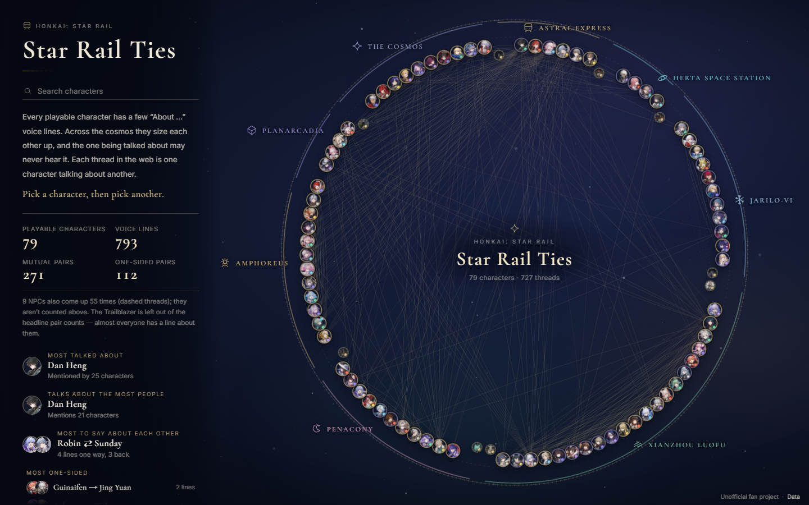
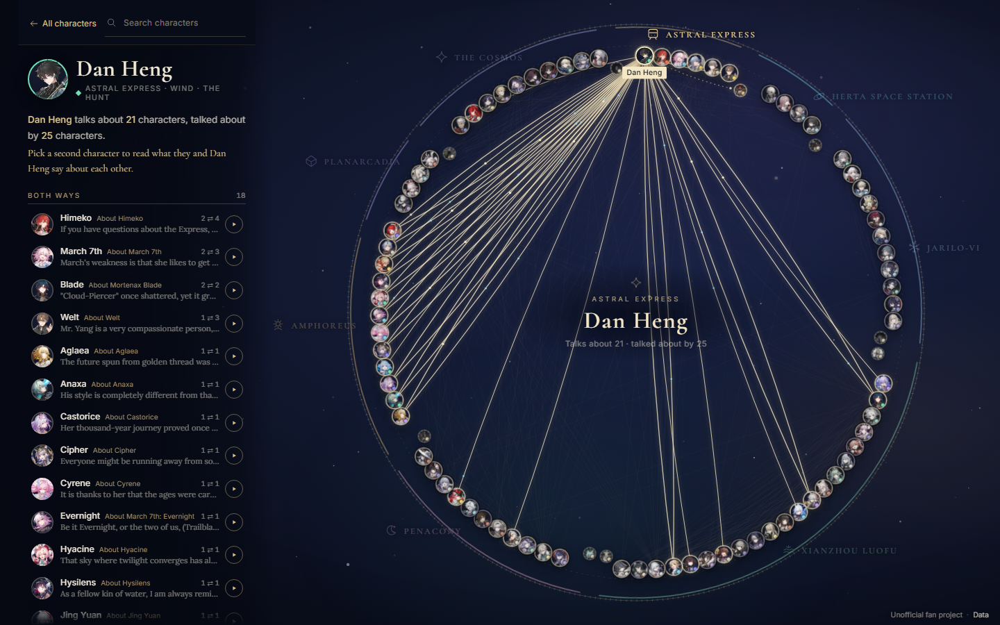
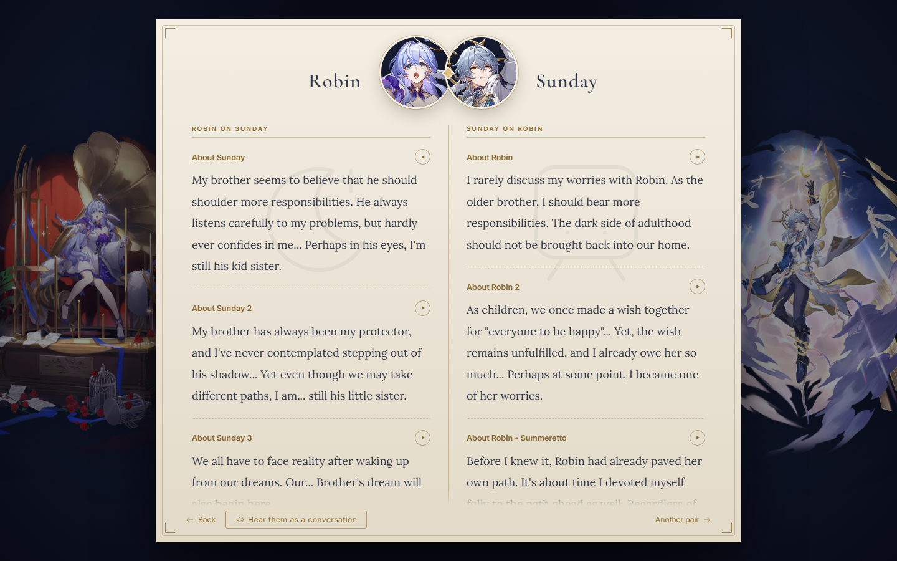

# Star Rail Ties

An unofficial, English-language relationship map for **Honkai: Star Rail**, inspired by [Genshin Ties](https://ties.catforest.dev/en/genshin).

Every playable character sits on a ring. Each thread is one character talking about another in their in-game **"About …"** archive voice line. Pick a character to see who they mention. Pick a second to read what each of them says about the other — and, where a recording exists, hear the two lines played as a conversation.



## Run it

The site is plain static files — no build step or server runtime is required.

```powershell
cd starrail-ties
python -m http.server 8765 --bind 127.0.0.1
```

Then open <http://127.0.0.1:8765/>. Any static file host works (GitHub Pages, Netlify, nginx, …). A local server is recommended over opening `index.html` directly because some browsers restrict media loading from `file://` pages.

## What you can do

- **Hover** a portrait for a quick summary and a snippet of what that character says.
- **Click one character** to light up their threads and list everyone they talk about, grouped into both-ways, one-way from them, and one-way about them.
- **Click a second character** to open the pair dossier: what each says about the other, the shared people they both mention, and a **"Hear them as a conversation"** button that plays the archive audio in order.
- **Search** at any time, or use the roster in the left panel (fully keyboard-accessible).
- **Open a random pair** from the panel, or use the **Another pair** button inside a dossier.
- **Share a view** with the URL hash: `#dan-heng` opens a character, `#robin+sunday` opens a pair.



*Selecting a character lights up their threads and lists everyone they talk about, split into both-ways and one-way groups.*



*A pair dossier shows what each says about the other, plus the people they both mention and a conversation player.*

## What the numbers mean

| Figure | Count |
| --- | --- |
| Playable characters | 79 |
| NPCs (talked about, no voice lines) | 9 |
| "About …" voice lines | 793 |
| Lines with audio | 756 |
| Mutual pairs (each mentions the other) | 271 |
| One-sided pairs | 112 |
| Directed threads on the web | 727 |

A few conventions:

- Only the English **"About …"** lines from each character's Voice-Overs page are used, not combat, story, or event dialogue.
- Alternate playable forms are folded into one person: Dan Heng • Imbibitor Lunae and Permansor Terrae → **Dan Heng**, Himeko • Nova → **Himeko**, The Herta → **Herta**, Fugue → **Tingyun**, Mortenax Blade → **Blade**, Robin • Summeretto → **Robin**, Silver Wolf LV.999 → **Silver Wolf**, Aventurine • Waveflair → **Aventurine**.
- NPCs appear as dashed threads. They never speak in the archive, so they are excluded from the pair counts.
- The **Trailblazer** is on the web but left out of the headline counts: nearly everyone has an "About the Trailblazer" line, which would flatten every ranking.
- A one-sided pair does not imply dislike. It usually just means one side has not had a line about the other yet.

## Data and rebuild pipeline

The generated site is self-contained: `data.js` holds all text, IDs, mentions, and audio URLs; `assets/icons/` and `assets/splash/` hold local artwork. The Python scripts are kept so the dataset can be refreshed.

```
scrape.py        Fandom API → raw_quotes.json (cached responses in cache/)
resolve_audio.py Fandom API → audio_urls.json (direct .ogg URLs)
build.py         raw_quotes.json + meta.json + factions.json + audio_urls.json
                 → data.js + assets/icons/*.webp + assets/splash/*.webp
```

Rebuild with:

```powershell
python -m pip install pillow
python scrape.py
python resolve_audio.py
python build.py
```

`build.py` only downloads images that are missing, so a rerun refreshes the data without re-fetching every portrait. Character portraits come from [StarRailRes](https://github.com/Mar-7th/StarRailRes) via jsDelivr; NPC portraits come from the Fandom wiki through an image proxy.

### Sources

- Voice lines and NPC portraits: [Honkai: Star Rail Wiki](https://honkai-star-rail.fandom.com/) (Fandom)
- Character icons and splash art: [StarRailRes](https://github.com/Mar-7th/StarRailRes)
- Cross-check: [HoYoWiki](https://wiki.hoyolab.com/pc/hsr/home)

### Audio

Recordings are **not bundled**. The site streams the original `.ogg` files from Fandom's static CDN at play time, so audio needs an internet connection and depends on Fandom being reachable from your network. If a file is missing or blocked, the conversation simply skips it. All character voices remain the property of HoYoverse.

## Project layout

```
index.html   page shell, pair-dossier markup, SVG icon sprite
style.css    layout, responsive rules, world labels, dossier styling
app.js       ring layout, canvas threads, interactions, search, audio playback
data.js      generated dataset (window.STARRAIL_TIES)
assets/      local icons and splash art
*.json       scraped/curated source data for the build scripts
```

## Disclaimer

This is an unofficial fan project. It is not affiliated with or endorsed by HoYoverse. *Honkai: Star Rail*, its characters, voice lines, artwork, and audio are © HoYoverse. The site is provided for personal, non-commercial reference and commentary. If you are a rights holder and want something removed, please open an issue.
